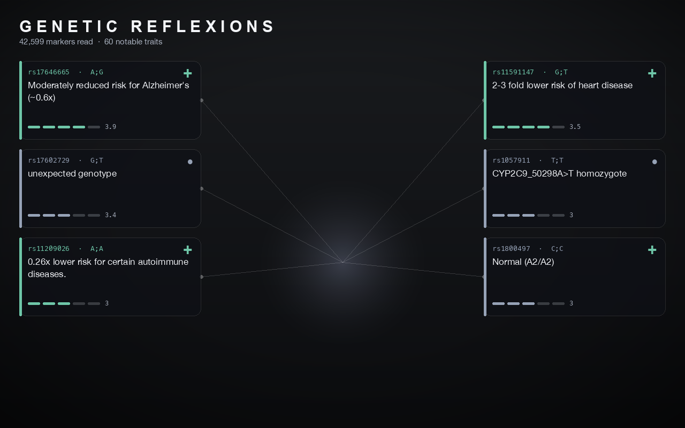

# Genetic Reflexions

> A magic mirror that casts away your phenotype in favour of your genotype —
> when you look into it, you see your genome, not your face.

Insert a USB drive with your [23andMe](https://www.23andme.com/) **or
[AncestryDNA](https://www.ancestry.com/dna/)** raw-data export and it parses your
~640,000–680,000 genetic markers, queries the live
[SNPedia](https://www.snpedia.com/) trait database, and floats your most notable
inherited traits around your live reflection: eye colour, muscle type, disease
risk, drug response, longevity markers, and more.

A Connecticut College student-research installation,
[*Genetic Reflexions*](https://www.conncoll.edu/academics/internships-student-research/student-research-projects/genetic-reflexions-a-magic-mirror-that-displays-genetic-info-about-the-person-with-their-reflection.html),
recipient of the 2021 Ammerman Center Bridget Baird Award.



## Install

```bash
python -m venv .venv && source .venv/bin/activate
pip install -e '.[camera]'      # full install incl. the live webcam mirror
pip install -e '.[web]'         # + the account/upload server (magic-mirror serve)
# ...or, for the poster / list / devices / chromosomes commands only (no OpenCV):
pip install -e .
```

Requires Python ≥ 3.10.

## Use

The mirror ships with a synthetic sample genome (`sample/genome.txt`) so every
command works immediately. Its marker ids and positions are real chip
coordinates; every genotype is random, and none SNPedia rates as bad or of
magnitude 4 or more is ever drawn, so the sample is nobody's DNA.
`scripts/make_sample_genome.py` regenerates it from any 23andMe export.

```bash
magic-mirror                     # live mirror (default), YuNet face tracking
magic-mirror live --fullscreen   #   Esc/q quit · s save a snapshot
magic-mirror poster out.png      # still image — no webcam / OpenCV needed
magic-mirror share me.jpg ig.png # decorate an existing photo for Instagram
magic-mirror report out.html     # full Promethease-style report (+ gene names)
magic-mirror gwas-report out.html# GWAS Catalog risk report (odds ratios, freqs)
magic-mirror list                # pretty table of your notable traits
magic-mirror devices             # genomes found on USB + the local dna/ folder
magic-mirror chromosomes         # markers split per chromosome (+ SNPedia matches)
magic-mirror resolve             # 23andMe "i" ids resolved to standard RSIDs
magic-mirror snapshot            # rebuild result.csv from a fresh live SNPedia walk
magic-mirror serve               # web upload + accounts server (needs '.[web]')
```

The mirror looks for your genome in three places, in order: an inserted **USB
stick**, then the local **`dna/` folder** in the project (just drop your 23andMe
file in there — it's git-ignored), then the bundled sample. `magic-mirror
devices` shows what it found; `--no-usb` skips the USB scan. Or point at a file
directly:

```bash
magic-mirror --genome ~/me_23andme.txt --min-magnitude 2.5 list
cp ~/me_23andme.txt dna/         # ...or just drop it in the local folder
```

### Trait data source

By default the mirror pulls traits **live from SNPedia** and caches them under
`.cache/` (first run ~1–2 min while it walks the API; later runs are instant).

```bash
magic-mirror --source live       # SNPedia API, cached (default)
magic-mirror --source csv        # frozen result.csv snapshot, fully offline
magic-mirror --source auto       # live, silently fall back to CSV offline
magic-mirror --refresh list      # ignore the cache and re-fetch
```

Changing `--min-magnitude` reuses the same cache — the live scan pulls a fixed
floor once and filters locally. Any knob can also be set via an `MIRROR_`
environment variable, e.g. `MIRROR_MIN_MAGNITUDE=2.5` (see `.env.example`).

### Full report (Promethease-style)

`report` generates a single **self-contained** HTML file (no CDN, no external
fonts/scripts — opens offline) covering *every* genotype SNPedia annotates, à la
[Promethease](https://promethease.com/):

```bash
magic-mirror report report.html               # interactive report
magic-mirror report report.html --csv out.csv # + a flat CSV of the same data
magic-mirror --source live report report.html # authoritative SNPedia "Repute"
```

Each genotype is colour-coded by SNPedia **Repute** — green *Good*, red *Bad*,
slate *Neutral* — tagged with its **gene** (scraped from the SNP page, cached),
and the page has live search (rsid / gene / genotype / condition / category),
repute toggles, a minimum-magnitude slider, good/bad/neutral tallies, and deep
links to every SNPedia page. With `--source live` the repute is SNPedia's own;
the offline CSV snapshot infers a coarse Good/Bad from each summary's category.
The same repute drives the `+ / − / •` glyph on the live mirror's trait cards.

### GWAS risk report (odds ratios + population frequencies)

`gwas-report` layers **GWAS Catalog** data on top — for your notable SNPs it
pulls the real risk allele, its population frequency, the reported trait, and the
p-value from EBI, then shows **how many copies of each risk allele you carry**
(0/1/2, colour-coded), sortable and searchable:

```bash
magic-mirror gwas-report gwas.html --csv gwas.csv   # ~200 SNPs, EBI GWAS Catalog
```

It queries the common-variant magnitude range (the catalog doesn't cover rare
Mendelian mutations), caches every lookup, and degrades gracefully offline. Full
per-ancestry frequencies (ALFA/gnomAD) are a further layer; this uses the
catalog's reported risk-allele frequency.

### Shareable export (photo → Instagram)

Already have a photo you like? `share` composites your trait cards around it and
writes an Instagram-ready image — with real face detection when OpenCV is
installed, so the connector lines lock onto your face (it falls back to a centred
layout otherwise).

```bash
magic-mirror share me.jpg out.png -f portrait   # 1080×1350 (IG feed 4:5)
magic-mirror share me.jpg out.png -f square     # 1080×1080
magic-mirror share me.jpg out.png -f story      # 1080×1920 (IG/TikTok story)
magic-mirror share me.jpg out.png --good        # only flattering "good news" traits
magic-mirror share me.jpg out.png --no-detect   # skip face detection
```

`--good` keeps only positive genotypes (never SNPedia "Bad"; the athletic /
longevity / cognition / protective / appearance ones) — ideal for a graphic you
actually want to post. Pair it with `--source live` for SNPedia's own repute.

The photo is cover-cropped (never stretched) to the target aspect, and taller
formats automatically fit more trait cards.

### Internal (`i`) id → RSID resolution

23andMe reports some markers under proprietary `i`-prefixed ids instead of
standard RSIDs, so they silently fail to match SNPedia/GWAS data. The mirror
translates them on load using a **partial, extensible** crosswalk
(`resources/iid_to_rsid.tsv`) — the full mapping was never published by 23andMe,
so this ships the *mechanism* and only ever applies verified rows, never guesses.

```bash
magic-mirror resolve             # how many "i" ids resolve; how many remain
magic-mirror resolve --show 20   # list still-unresolved internal ids
```

Add mappings by appending `i<id><TAB>rs<id>` lines to the crosswalk (the file
header explains how to source them from SNPedia). Disable with `--no`-style
`MIRROR_RESOLVE_IIDS=false`.

### Per-chromosome split & genome comparison

Splits the genome into its 24 chromosomes and, optionally, diffs it against a
second genome — the project's original research analysis, now a tested command:

```bash
magic-mirror chromosomes                      # markers + SNPedia matches per chr
magic-mirror chromosomes --compare relative.txt    # concordant vs discordant SNPs
magic-mirror chromosomes --compare relative.txt --output discordant.csv
```

`--compare` reports, per chromosome, how many SNPs the two genomes share and how
many disagree (the raw material for parent/child checks) plus an overall
concordance rate.

### Web upload + accounts (`serve`)

The project's stated next step — upload a genome to a server, tie it to an
account, and have the mirror read it back on login — as a runnable scaffold:

```bash
pip install -e '.[web]'
magic-mirror serve               # http://127.0.0.1:8000  (open / for the form)
```

| Method & path | Purpose |
| --- | --- |
| `POST /api/register` | create an account (`{username, password}`) |
| `POST /api/login` | get a bearer token |
| `POST /api/genomes` | upload a 23andMe / AncestryDNA file (multipart, auth) |
| `GET  /api/genomes` | list your uploaded genomes |
| `GET  /api/genomes/{id}/traits` | the mirror pulls a user's traits from here |
| `POST /api/genomes/{id}/share?fmt=` | upload a photo, get an Instagram-ready PNG back |

Accounts and files live under `web_data/` (SQLite + PBKDF2-hashed passwords;
uploads are validated and scoped per user). It's a scaffold, not a hardened
service — run it behind TLS and review the auth before any real deployment.

## Architecture

Layered so each stage is independently useful and testable:

| Module | Responsibility |
| --- | --- |
| `genetics.py` | Pure genotype helpers (normalise, parse titles) |
| `iids.py` | Translate 23andMe internal `i` ids to standard RSIDs |
| `genome.py` | Stream a 23andMe / AncestryDNA file into `rsid → genotype` calls |
| `snpedia/` | Trait table (`live.py`/`parse.py`), gene scrape (`genes.py`), GWAS (`gwas.py`) |
| `traits.py` | Join genome × SNPedia, rank by magnitude, categorise, repute, coolness |
| `report.py` | Self-contained interactive HTML report (+ CSV) |
| `chromosomes.py` | Per-chromosome split + two-genome concordance/discordance |
| `sources.py` | Discover a genome on USB media or the local `dna/` folder |
| `web/` | *Optional* FastAPI upload/accounts server (`storage.py`, `app.py`) |
| `detect.py` | Face detection — YuNet DNN, Haar fallback, EMA smoothing |
| `camera.py` | *Optional* OpenCV webcam capture |
| `theme.py` / `render.py` | Pillow compositor — cards, meters, vignette |
| `app.py` | Orchestration: live loop and still poster |
| `cli.py` | Typer + Rich command line |

Genotypes match **order-independently** (`AG` == `GA`), and everything except
`camera.py` / the DNN detector runs without OpenCV — so the poster, list and
devices commands and the whole test suite work on a plain box.

**Built with:** Pydantic-settings (config), Typer + Rich (CLI), httpx (SNPedia),
OpenCV YuNet (face detection), Pillow + numpy (rendering).

## Develop

```bash
pip install -e '.[dev,camera]'
pytest                 # ~105 tests, no network or webcam required
ruff check .
```

## Native core & edge (Rust)

A small Rust workspace under [`rust/`](rust/) holds the performance-critical
core, shared by two run-times:

| Crate | What it is |
| --- | --- |
| `genome-core` | Portable parse + SNPedia join + category/repute logic (one source of truth) |
| `genome-py` | PyO3 bindings → the `genome_core` Python module (built with `maturin`) |
| `genome-worker` | A **Cloudflare Worker** (WASM): `POST /traits` parses a genome and returns SNPedia trait JSON |

The Python package uses the native parser automatically **when it's built**, and
falls back to pure Python otherwise (so nothing is required):

```bash
pip install maturin
cd rust/crates/genome-py && maturin develop --release   # ~2.4x on parse+join
```

The edge Worker bundles the SNPedia snapshot and is self-contained — deploy with
[Wrangler](https://developers.cloudflare.com/workers/):

```bash
cd rust/crates/genome-worker
wrangler dev      # local:  curl -X POST --data-binary @genome.txt localhost:8787/traits
wrangler deploy   # to your Cloudflare account
```

The live camera mirror stays local (it needs a webcam); the Worker is the path
to serving trait lookups at the edge for a web front end.

## Privacy

Your genome never leaves your machine. In live mode the only outbound requests
ask SNPedia for its *public* list of notable genotypes (a generic
"magnitude ≥ N" query — none of your data is sent); the genome × SNPedia match
happens entirely locally. Use `--source csv` for a fully offline run.

## License

The code is [AGPL-3.0-or-later](LICENSE). `result.csv` is a snapshot of
[SNPedia](https://www.snpedia.com/), licensed
[CC BY-NC-SA 3.0](LICENSES/CC-BY-NC-SA-3.0.txt): attribution to SNPedia,
non-commercial use, share-alike. `cascadeFiles/haarcascade_frontalface_default.xml`
is from OpenCV under the Intel license reproduced at the top of that file.
